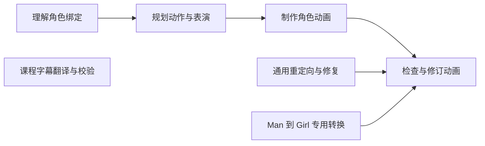

# OZO Blender Skills

为 Codex 整理的 **7 个自定义 Blender Skills**，按工作领域和制作阶段分类，包含工作方法、按需参考、辅助脚本和特定骨架校准资料。

这些是供 AI 助手使用的 Skills；Blender 插件源码另见 [OZO Tools](https://github.com/ozoshanniao/ozo-tools)。

## 分类导航

| 大类 | 阶段 / 子类 | Skill | 用途 |
| --- | --- | --- | --- |
| 绑定分析 | 理解绑定 | [blender-rig-understand](skills/rigging/blender-rig-understand/SKILL.md) | 读取角色骨架，建立控制器职责、IK/FK 和空间档案 |
| 角色动画 | 表演规划 | [blender-performance-plan](skills/animation/blender-performance-plan/SKILL.md) | 编排动作节奏、关键姿态、接触事件及性格表演 |
| 角色动画 | 动画制作 | [blender-character-animate](skills/animation/blender-character-animate/SKILL.md) | 从零制作或修改可播放的角色动画 |
| 角色动画 | 检查与修订 | [blender-animation-review](skills/animation/blender-animation-review/SKILL.md) | 检查求值姿态、网格形变、接触、轨迹、循环和衔接 |
| 动画重定向 | 通用流程与修复 | [blender-retarget-repair](skills/retargeting/blender-retarget-repair/SKILL.md) | 映射分析、参考姿态协作和重定向后的系统问题修复 |
| 动画重定向 | 特定骨架预设 | [blender-man-girl-transfer](skills/retargeting/blender-man-girl-transfer/SKILL.md) | Man → Girl 的静止基转换、前臂扭转拟合及骨架验收 |
| 课程字幕 | 翻译与校验 | [blender-subtitle-translate](skills/subtitles/blender-subtitle-translate/SKILL.md) | Blender 英语 SRT → 简体中文及中英双语字幕 |

详细的输入、输出、依赖、修改范围、适用限制和调用示例见 [Skills 分类目录](docs/CATALOG.md)。

## 推荐工作流



- **自己制作动画**：绑定分析 → 表演规划 → 动画制作 → 动画检查。
- **给其他角色复用动作**：通用重定向流程 → 求值姿态和接触检查。
- **匹配已校准的 Man / Girl 绑定**：专用转换 → 骨架验收 → 网格与接触检查。
- **学习 Blender 课程**：字幕翻译独立使用，不需要连接 Blender。

## 目录结构

```text
skills/
├── rigging/                         绑定与控制器分析
│   └── blender-rig-understand/
├── animation/                       角色动画制作周期
│   ├── blender-performance-plan/    规划
│   ├── blender-character-animate/   制作
│   └── blender-animation-review/    检查 / 修订
├── retargeting/                     动画重定向
│   ├── blender-retarget-repair/     通用协作流程
│   └── blender-man-girl-transfer/   单一骨架对的校准预设
└── subtitles/                       课程语言与字幕
    └── blender-subtitle-translate/
docs/
├── CATALOG.md                       详细分类、输入输出和示例
├── INSTALLATION.md                  安装、依赖与启用
└── VALIDATION.md                    本次发布验证及边界
skill-index.json                     机器可读分类索引
scripts/validate.py                  仓库结构、引用与脚本静态检查
```

## 安装与使用

下载仓库后，按需将某个 **完整 Skill 文件夹**复制到用户级 `~/.agents/skills/` 或项目级 `.agents/skills/`。分类目录只用于组织源码；安装时保留叶级 Skill 的原名和完整内容。

例如：`skills/animation/blender-character-animate/` → `~/.agents/skills/blender-character-animate/`。

也可以让 Codex 的 `$skill-installer` 按仓库地址和具体 Skill 路径安装。详见 [安装说明](docs/INSTALLATION.md)，路径依据 [OpenAI 官方文档](https://learn.chatgpt.com/docs/build-skills#where-codex-loads-local-skills)。

调用示例：

```text
请使用 $blender-rig-understand 分析当前角色的控制器职责和 IK/FK。
请使用 $blender-performance-plan 规划一个自然的转身并打招呼动作。
请使用 $blender-animation-review 检查当前动作的脚滑和循环衔接。
```

连接场景的 Skills 需要可用的 Blender MCP。通用重定向流程还需要当前实际使用的重定向工具；Man → Girl 预设自带转换脚本，不依赖 OZO Tools 或 ARP。

## 使用约定与适用范围

分析与制作按请求区分；身体位移 / 旋转的写入位置、轴和根运动方案须按 Skill 约定先确认。保留原动作和用户手调，不自动保存 `.blend`。这些工作约定随自定义 Skills 保留，安装本仓库本身不授权修改任何场景。

Man → Girl 预设只支持随附校准匹配的骨架对和模式，不能视作通用重定向器。通用技能的具体可用性取决于实际角色、Blender、MCP 和所用插件版本。

本仓库包含必要脚本与校准 JSON，不包含角色模型、原始动画、课程视频或课程字幕。公开副本已去除个人绝对路径及聊天编号；本机已安装的 Skills 未被改写。

## 验证与许可证

结构检查：`python scripts/validate.py`。发布时的检查结果和未覆盖部分见 [验证记录](docs/VALIDATION.md)。

[GNU GPL v3 或更新版本](LICENSE)。保留转换核心原有的 GPL-3.0-or-later 标记。
